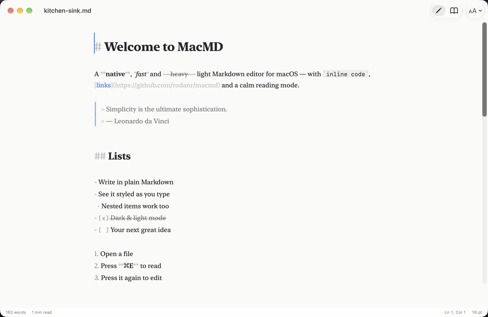
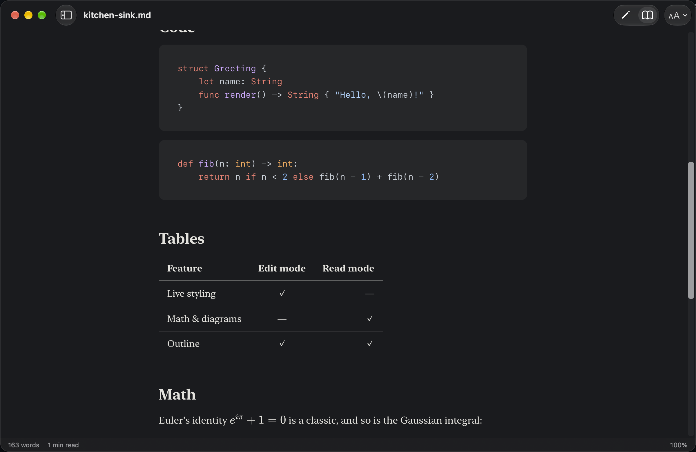
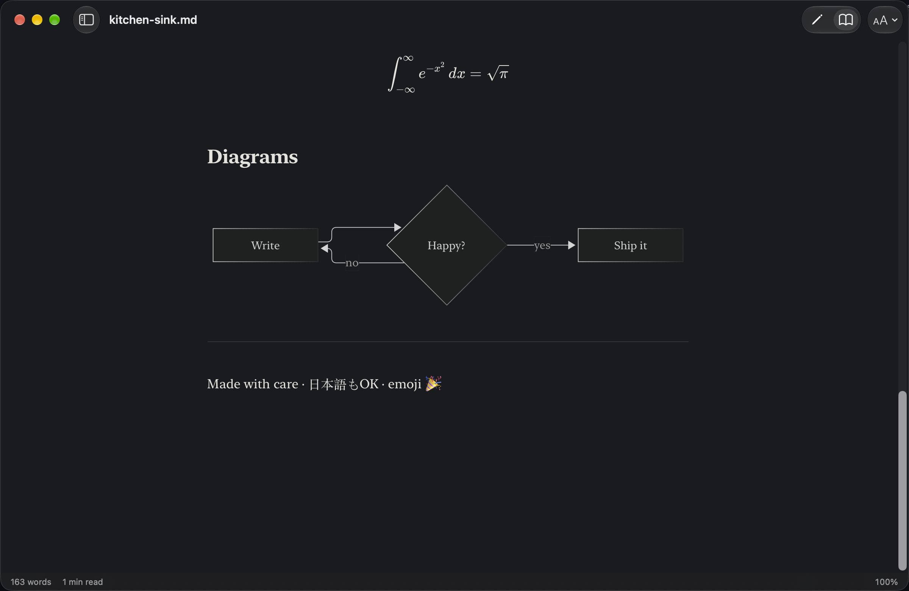

<div align="center">


# MacMD

**A quiet, native Markdown editor and reader for the Mac.**

Write in plain Markdown that styles itself as you type, then press ⌘E to read it as a beautifully set page.

[](https://github.com/rodanr/MacMD/actions/workflows/ci.yml)
[](https://github.com/rodanr/MacMD/releases/latest)
[](https://github.com/rodanr/MacMD/releases)


[](LICENSE)

[**Download**](https://github.com/rodanr/MacMD/releases/latest) · [Features](#features) · [Shortcuts](#keyboard-shortcuts) · [Build from source](#build-from-source)

</div>

<p align="center">
  
  
</p>

## Why MacMD

- **Native.** Built with AppKit, SwiftUI and TextKit 2, so it behaves like a Mac app: autosave, versions,
  tabs, spelling, Find, Services and your system accent color.
- **Light.** About 50 MB of memory with a document open, a 5 MB download, and no Electron or background work.
- **Honest Markdown.** Your file stays plain text. Syntax is shown faintly, never hidden, so what you see
  is exactly what you save.
- **Beautiful.** Set in New York, SF Pro or SF Mono, with a readable line length and careful spacing in
  light and dark.
- **Private.** No accounts, analytics or telemetry. MacMD only goes online when you ask it to
  ([Terms & Privacy](TERMS.md)).

## Features

| | |
|---|---|
| **Live styling** | Headings, emphasis, code, quotes, lists, task lists, tables, links and math are styled as you type |
| **Read mode** | ⌘E switches to a typeset page, keeping your place in the document |
| **Code, math, diagrams** | Syntax highlighting (highlight.js), TeX math (KaTeX) and Mermaid diagrams, all offline |
| **Outline & files** | Jump between headings, or browse the Markdown files in a folder |
| **Focus & typewriter** | Dim everything but the current paragraph (F8), keep the caret centered (F9) |
| **Smart editing** | Lists, quotes and tasks continue on Return; Tab indents; typing `*`, `` ` `` or `[` around a selection wraps it |
| **Vim mode** | For people who think in motions. Optional, and off until you turn it on in Settings |
| **Images** | Drop or paste images; MacMD inserts a relative link and saves pasted images next to your document |
| **Themes & sizes** | Paper, Clean and Mono, each in light and dark; set the font size, or zoom the whole window |
| **Export** | HTML, PDF, Print, and Copy as HTML |
| **Stays in sync** | Reloads automatically when another app changes the file |

<p align="center">
  
</p>

## Install

Requires macOS 26 Tahoe or later on Apple silicon.

1. Download `MacMD-<version>.dmg` from the [latest release](https://github.com/rodanr/MacMD/releases/latest).
   Only download MacMD from this page.
2. Open the DMG and drag **MacMD** onto **Applications**.
3. Open MacMD from Applications. The first time, macOS shows **"MacMD" Not Opened**. Click **Done**
   (not *Move to Trash*).
4. Open **System Settings → Privacy & Security** and scroll down to **Security**. Next to
   *"MacMD" was blocked to protect your Mac*, click **Open Anyway** and confirm with your password or Touch ID.
5. In the dialog that follows, click **Open Anyway** once more.

You only do this once. Updates you install the same way ask again, once per version.

<details>
<summary>Prefer Terminal?</summary>

After step 2, this removes the download quarantine flag so MacMD opens normally:

```sh
xattr -dr com.apple.quarantine /Applications/MacMD.app
```

</details>

### Why the warning, and can I trust MacMD?

macOS shows this warning for any app that hasn't been *notarized*: checked and signed through Apple's paid
Developer Program. MacMD is a free, independent project and isn't enrolled yet, so Apple has simply never
looked at it. The warning means "not verified by Apple", not "harmful". Releases will be notarized once the
project joins the program, and these steps will go away.

You don't have to take our word for it:

- **The code is open.** Every line is in this repository under the [MIT License](LICENSE).
- **Releases are built in public.** GitHub Actions builds each DMG from the tagged source; the
  [build logs](https://github.com/rodanr/MacMD/actions/workflows/release.yml) are public.
- **You can verify your download.** Each release has a SHA-256 checksum. Releases after 0.1.0 also carry a
  GitHub build attestation that proves the DMG came from this repository's release workflow, unmodified:

  ```sh
  shasum -a 256 -c MacMD-<version>.dmg.sha256          # in the folder with both files
  gh attestation verify MacMD-<version>.dmg --repo rodanr/MacMD   # releases after 0.1.0
  ```

- **It stays private.** No accounts, analytics or telemetry. MacMD only goes online when you ask it to
  ([Terms & Privacy](TERMS.md)).
- **Or build it yourself** from source in a few minutes; see [Build from source](#build-from-source).

MacMD is in early development (version 0.x), so features and settings may still change between versions.
Every release is listed in the [changelog](CHANGELOG.md), and **MacMD → Check for Updates…** tells you when
a new one is out.

You can also open files from a terminal:
`/Applications/MacMD.app/Contents/MacOS/MacMD notes.md`.

## Keyboard shortcuts

| Action | Shortcut | | Action | Shortcut |
|---|---|---|---|---|
| Edit / Read mode | ⌘E | | Bold / Italic | ⌘B / ⌘I |
| Sidebar / Outline / Files | ⌃⌘S / ⌃⌘1 / ⌃⌘2 | | Link | ⌘K |
| Focus mode | F8 | | Inline code | ⇧⌘K |
| Typewriter mode | F9 | | Strikethrough | ⇧⌘X |
| Zoom in / out / actual size | ⌘+ / ⌘- / ⌘0 | | Heading 1–6 / Paragraph | ⌘1–⌘6 / ⌥⌘0 |
| Bigger / smaller font | ⌥⌘+ / ⌥⌘- | | | |
| Export HTML / PDF | ⇧⌘E / ⌥⌘E | | Indent / Outdent list | Tab / ⇧Tab |
| Find / Replace | ⌘F / ⌥⌘F | | Settings | ⌘, |

## Build from source

Requirements: macOS 26+, Xcode 26+, and [XcodeGen](https://github.com/yonaskolb/XcodeGen).

```sh
brew install xcodegen
git clone https://github.com/rodanr/MacMD.git && cd MacMD
make run      # generate the project, build, launch
make test     # unit tests + UI smoke tests
make dmg      # build/MacMD-<version>.dmg
```

`make help` lists every task. The Xcode project is generated from `project.yml`.

## How it's built

```
Packages/MacMDKit   Markdown logic, no UI (swift-markdown) — style spans, HTML, outline, editing rules
App/                AppKit documents & menus · SwiftUI views · TextKit 2 editor · WKWebView reader
```

The editor parses off the main thread and restyles only the blocks that changed. It never touches your
characters, only their attributes. Read mode renders through a custom `macmd://` scheme whose
Content Security Policy blocks scripts in documents. [ARCHITECTURE.md](docs/ARCHITECTURE.md) has the details,
and [DESIGN.md](docs/DESIGN.md) has the typography and color tokens.

## Contributing

Issues and pull requests are welcome. Start with [CONTRIBUTING.md](CONTRIBUTING.md). The repository is set
up for AI-assisted development as well: [CLAUDE.md](CLAUDE.md) and the playbooks in `.claude/skills/` describe
how to build, test, add Markdown features and themes, and cut releases.

## License

MacMD is made by Rodan Ramdam and released under the [MIT License](LICENSE). It is provided as is, without
warranty; see [Terms & Privacy](TERMS.md). Bundled third-party components are listed in
[THIRD_PARTY_NOTICES.md](THIRD_PARTY_NOTICES.md). MacMD is not affiliated with Apple Inc.
